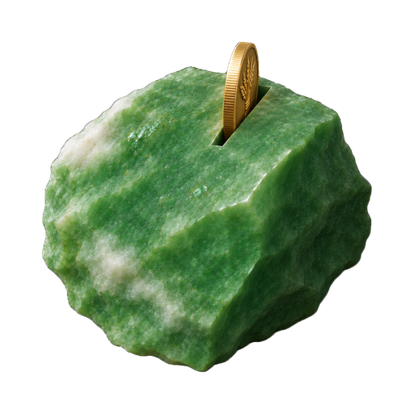

# Grocery Flywheel brand mark

One raw, rough-broken chunk of green aventurine with a thick gold-brass coin dropped edge-first into a long sawn slit along its top ridge. The coin stands parallel to the slit, like a coin going into a piggy bank (owner, 2026-11-10: turned 90° from the earlier face-on coin; pick r16 C).

| File | Size | Use |
|---|---|---|
| `grocery-flywheel.png` | 1024×1024 | Master, transparent background |
| `grocery-flywheel-512.png` | 512×512 | README hero, app icon |
| `grocery-flywheel-192.png` | 192×192 | PWA and touch icon |
| `grocery-flywheel-32.png` | 32×32 | Favicon raster |

Part of the KyaniteLabs crystal icon family. Approved at the owner's eye-gate on 2026-11-10. Lockup: **GROCERY FLYWHEEL** in Chakra Petch Bold 700 with "by KyaniteLabs" in Chakra Petch Medium 500. The reasoning is in `docs/DESIGN-PREFLIGHT.md`.
